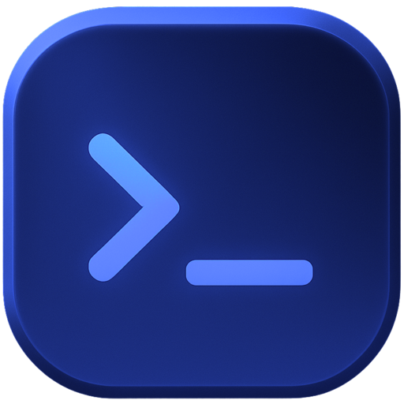

<p align="center"></p>

# Runcrate MCP

Give your AI agent GPUs. Runcrate is a GPU cloud for AI developers and agents: connect it once, then ask in plain words. Your agent sees live GPU prices, launches a GPU on a ready image, runs your command as a job whose machine stops (and stops billing) when the command exits, schedules runs, moves files, and checks your spend.

- Server: `https://mcp.runcrate.ai/mcp` (streamable HTTP)
- Sign-in: OAuth in your browser. No key to copy, nothing to paste into a config file.
- 47 tools: instances, jobs, schedules, files, volumes, firewall and HTTPS links, billing, environments and secret names. [Tool reference](https://runcrate.ai/docs/mcp/tools)

You pick one environment when you sign in. The agent acts only there, and that environment's monthly budget caps what it can spend.

## Connect your agent

Paste this one line into your agent: Claude Code, Codex, Cursor, VS Code, OpenCode, or any agent that can run a command. It adds the server to itself, and its first Runcrate tool call opens your browser to sign in.

```text
Add Runcrate's MCP server to yourself: run curl -fsSL "https://runcrate.ai/mcp.md" and follow it.
```

Or one click:

[](https://cursor.com/en/install-mcp?name=runcrate&config=eyJ1cmwiOiJodHRwczovL21jcC5ydW5jcmF0ZS5haS9tY3AifQ==)
[](https://vscode.dev/redirect/mcp/install?name=runcrate&config=%7B%22type%22%3A%22http%22%2C%22url%22%3A%22https%3A%2F%2Fmcp.runcrate.ai%2Fmcp%22%7D)
[](https://insiders.vscode.dev/redirect/mcp/install?name=runcrate&config=%7B%22type%22%3A%22http%22%2C%22url%22%3A%22https%3A%2F%2Fmcp.runcrate.ai%2Fmcp%22%7D&quality=insiders)

In Claude Code, the plugin adds the server and a skill that teaches Claude how to spend safely: `/plugin marketplace add runcrateai/runcrate-mcp`, then `/plugin install runcrate@runcrate`. In Gemini CLI: `gemini extensions install https://github.com/runcrateai/runcrate-mcp`.

Claude and ChatGPT on the web can't run a command, so they take the URL as a custom connector (steps below).

<details>
<summary>Set it up by hand</summary>

With the Runcrate CLI, one command connects every client it finds on your machine:

```bash
runcrate mcp install
```

### Claude Code

```bash
claude mcp add --transport http --scope user runcrate https://mcp.runcrate.ai/mcp
```

Then run `/mcp` in Claude Code and pick `runcrate`: your browser opens to sign in.

### Claude (claude.ai and Claude Desktop)

1. Open **Settings > Connectors** and choose **Add custom connector**.
2. Name it `Runcrate` and paste `https://mcp.runcrate.ai/mcp`.
3. Choose **Connect** and sign in to Runcrate in the window that opens.

### ChatGPT

1. Open [chatgpt.com/plugins](https://chatgpt.com/plugins), choose **+**, then **Add custom MCP server**.
2. Name it `Runcrate` and paste `https://mcp.runcrate.ai/mcp` as the URL, with OAuth.
3. Create it, sign in to Runcrate, then mention `@Runcrate` in a chat.

### Codex

```bash
codex mcp add runcrate --url https://mcp.runcrate.ai/mcp
```

Codex opens your browser to sign in. Closed it? Run `codex mcp login runcrate`.

### Windsurf and Devin

Run `runcrate mcp install --client windsurf`, or add a server in Cascade's MCP settings with the URL `https://mcp.runcrate.ai/mcp`. Devin CLI: `devin mcp add -s user runcrate https://mcp.runcrate.ai/mcp`, then `devin mcp login runcrate`.

### Zed, Warp, Goose, Raycast and any other MCP client

Give the client the URL `https://mcp.runcrate.ai/mcp` and choose OAuth (dynamic registration). It signs you in through your browser on first use.

### Config files

Cursor (`~/.cursor/mcp.json`), Warp (`~/.warp/.mcp.json`) and most clients:

```json
{ "mcpServers": { "runcrate": { "url": "https://mcp.runcrate.ai/mcp" } } }
```

VS Code (`mcp.json` in your user profile):

```json
{ "servers": { "runcrate": { "type": "http", "url": "https://mcp.runcrate.ai/mcp" } } }
```

Windsurf (`mcp_config.json`): `{ "mcpServers": { "runcrate": { "serverUrl": "https://mcp.runcrate.ai/mcp" } } }`

Zed (`settings.json`): `"context_servers": { "runcrate": { "url": "https://mcp.runcrate.ai/mcp" } }`

Gemini CLI (`~/.gemini/settings.json`): `{ "mcpServers": { "runcrate": { "httpUrl": "https://mcp.runcrate.ai/mcp" } } }`

Codex (`~/.codex/config.toml`):

```toml
[mcp_servers.runcrate]
url = "https://mcp.runcrate.ai/mcp"
```

Goose (`~/.config/goose/config.yaml`):

```yaml
extensions:
  runcrate:
    name: Runcrate
    type: streamable_http
    uri: https://mcp.runcrate.ai/mcp
    enabled: true
```

</details>

## Try it

> Launch an H100 with the Finetune crate and run nvidia-smi.

> Run python train.py on an A100 as a job, at most 2 hours, and follow the logs.

> How much of this month's budget is left?

## What is in this repo

| File | For |
| --- | --- |
| `.claude-plugin/` and `.mcp.json` | Claude Code plugin and marketplace |
| `plugin.json` and `mcp.json` | [Agent Plugins](https://agent-plugins.org) package (Cursor, ChatGPT, Codex) |
| `.cursor-plugin/plugin.json` | Cursor Marketplace |
| `gemini-extension.json` | Gemini CLI extension |
| `skills/runcrate/SKILL.md` | The skill every package ships: how to pick jobs or instances and keep spend in check |

The server itself is hosted by Runcrate; this repo only packages the connection. It is listed in the [official MCP registry](https://registry.modelcontextprotocol.io/v0/servers?search=io.github.aeonmindai/runcrate) as `io.github.aeonmindai/runcrate`.

## Links

- Docs: https://runcrate.ai/docs/mcp/setup
- Product: https://runcrate.ai/mcp
- CLI: https://github.com/runcrateai/runcrate-cli
- Support: support@runcrate.ai
- Privacy: https://www.runcrate.ai/privacy
- Terms: https://www.runcrate.ai/terms

MIT licensed.
